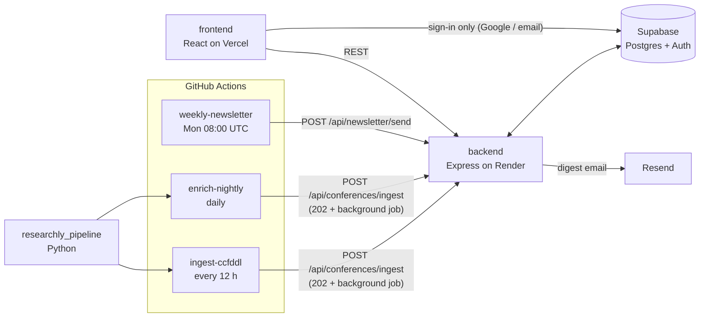

# Researchly.io

An academic platform for finding conferences you can trust and the people to submit with:

- **Discover** live conference deadlines (ongoing and upcoming), filter by field, ranking, location and timeline.
- **Credibility audit** for every venue: an evidence-based risk report that scores only what it could verify.
- **Academic network**: a LinkedIn-style feed (everyone or only your connections), connections, communities.
- **Reminders** straight into Google Calendar, and an opt-in **weekly digest** email.
- **AI tools**: paper-to-venue matcher, submission Kanban tracker, LLM peer-review feedback.

| | |
|---|---|
| Website | https://researchly-internship.vercel.app |
| API | https://researchly-internship.onrender.com/api |
| Health check | https://researchly-internship.onrender.com/api/auth/status |

---

## Architecture



The browser talks to Supabase **only for sign-in**. All data goes through the backend, which uses the service-role key;
row-level security keeps the public anon key from reading or changing anyone's data directly.

```
.
├── backend/                     Express API (Node 18+)
│   ├── src/
│   │   ├── routes/              auth, conferences (+ ingest), credibility, posts, network, applications,
│   │   │                        paper-reviews, ai-match, newsletter
│   │   ├── services/            credibilityEngine, ingestService, lookups (DBLP/RDAP/OpenAlex), feed,
│   │   │                        newsletter, userContext, matchingEngine, llmService, scheduler
│   │   ├── db/                  supabase.js (clients), store.js (Supabase + in-memory fallback), seed data
│   │   └── config/env.js        all environment variables
│   ├── schema.sql               full database schema for a NEW Supabase project (includes 001–008)
│   ├── migrations/              001–008, only for upgrading an existing database
│   ├── scripts/credibility_eval.mjs
│   └── test/                    node:test suites
├── frontend/                    React + Vite + Tailwind (design tokens, dark mode)
│   ├── src/pages/               Home (feed), Discover, ConferenceDetail, AiMatcher, Applications,
│   │                            PaperReview, Network, Communities, Profile, AuthModal
│   ├── src/components/          Navbar, ConferenceCard, ReminderBell, NewsletterCard, RiskBadge, …
│   ├── src/lib/                 api, discover (filters/timeline), calendar, coverage, deadline (+ tests)
│   └── vercel.json              SPA rewrites for Vercel
├── researchly_pipeline/         Python scrapers, grounded LLM enrichment, dedup, live lookups
├── .github/workflows/           ingest-ccfddl, enrich-nightly, weekly-newsletter
├── .github/scripts/push_ingest.sh
└── render.yaml                  Render blueprint for the API
```

---

## Features

### Feed and network (`/`, `/network`, `/communities`)
- **All posts / My connections** tabs. "All" shows public posts plus connections-only posts from people you are
  connected with; "My connections" shows only your connections (and you). The choice is remembered.
- Each post is **Anyone** or **Connections only**, enforced by the server (and by RLS in the database).
- Likes, comments and shares are stored per user; the liked state survives a reload.
- AI Post Assist drafts posts (preprint milestones, acceptances, CFP reminders).
- Connection requests, accept/reject/disconnect, interest-based recommendations.

### Discover (`/discover`)
- Defaults to **ongoing and upcoming** events; past events via the Timeline filter. Filters live in the URL.
- Dates are evaluated "anywhere on earth" so nothing shows as closed early; missing dates show **TBA**.
- Location filter (country with counts, Online / Hybrid, city search, "Location not stated"), sort by soonest
  deadline, client-side pagination.

### Reminders (🔔 on every card and "Remind me" on the detail page)
Opens a pre-filled Google Calendar event: **submission deadline** (timed when the time zone is known, otherwise
all-day), **1 week before**, and **conference dates**. No Google API key or extra login is needed, and an option is
only offered when the record actually has that date.

### Weekly digest
Opt-in switch on the Profile page with **Preview this week's email**. Each Monday the digest lists new
connections, pending requests, up to 5 posts from your network, and newly listed events with open deadlines.
A quiet week says so; nothing is invented. Sent through [Resend](https://resend.com); without `RESEND_API_KEY`
the send is a dry run.

### Sign-in
Email + password (**no confirmation email**: accounts are created already confirmed), Google and GitHub via
Supabase OAuth. A profile row is created on first sign-in.

### Credibility audit (`/conferences/:id`)
- The LLM only **extracts quotes**; code verifies each quote against the fetched page; a deterministic engine scores.
  The LLM never outputs a score.
- Nine dimensions (domain, organizer, publisher, indexing, committee, history, venue, fees, contact). A check that
  could not run is **Not checked**, never a default good score.
- Below **30 % coverage** the score is withheld: the page shows **Not enough evidence** and, at most, a labelled
  provisional figure. A failed check still means High risk.
- Indexing uses **DBLP (not Scopus)**; Scopus / Web of Science claims are never marked verified.
- HTTPS is information only; the domain dimension is scored only once RDAP domain age has run.
- Evidence timeline with source URL, quote and date for every check; deadline drift history.

### AI tools
- **Paper-to-venue matcher** (`/ai-match`): TF-IDF and topic overlap, grouped into open / closing soon / historical.
- **Applications tracker** (`/applications`): Bookmarked → Drafting → Under Review → Accepted / Rejected, private
  to each user.
- **Paper review** (`/paper-review`): upload or paste a draft for a structured LLM review; saved to your account.

---

## Run locally

Requires Node 18+ and Python 3.11+ (pipeline only).

```bash
# backend  -> http://localhost:5001
cd backend && npm install
cp .env.example .env        # then fill in your own values (see below)
npm start

# frontend -> http://localhost:3000
cd frontend && npm install
cp .env.example .env
npm run dev
```

Without Supabase keys the backend runs on an in-memory store with a hand-entered seed list, so you can try the UI
offline. Nothing is saved across restarts in that mode.

### Environment variables

**Backend** (`backend/.env`, and Render → Environment):

| Variable | Required | Purpose |
|---|---|---|
| `SUPABASE_URL` | yes | `https://<project-ref>.supabase.co`, nothing after `.co` |
| `SUPABASE_SERVICE_ROLE_KEY` | yes | Secret key. Needed for no-confirmation sign-up and with the RLS policies |
| `SUPABASE_ANON_KEY` | yes | Publishable key, used for password sign-in |
| `GEMINI_API_KEY` | for AI | Post assist, matcher, paper review |
| `INGEST_TOKEN` | for ingest | Long random string; must equal the GitHub secret (`openssl rand -hex 32`) |
| `RESEND_API_KEY` | for digest | Without it the weekly send is a dry run |
| `NEWSLETTER_FROM` | for digest | e.g. `Researchly <digest@your-verified-domain>` |
| `SITE_URL` | for digest | Public frontend URL, used for links in emails |
| `ENABLE_CURATED_SEED` | no | `false` hides the hand-entered seed list once pipeline data exists |
| `ENABLE_LIVE_CHECKS` | no | `true` runs DBLP + RDAP lookups during audits (default `false`) |
| `OPENALEX_MAILTO` | no | Contact for OpenAlex's polite pool; never hard-coded |
| `PORT`, `CRON_INTERVAL_HOURS` | no | Defaults `5001`, `12` |

**Frontend** (`frontend/.env`, and Vercel → Environment Variables; redeploy after changing):

| Variable | Value |
|---|---|
| `VITE_API_BASE_URL` | `https://<render-service>.onrender.com/api` (or `http://localhost:5001/api`) |
| `VITE_SUPABASE_URL` | `https://<project-ref>.supabase.co` (the URL, **not** the key) |
| `VITE_SUPABASE_ANON_KEY` | Publishable / anon key only. Never put the service-role key in the frontend |

> Never commit real keys. Keep them in `.env` (git-ignored) and the hosting dashboards; `.env.example` files hold
> placeholders only.

---

## Database (Supabase)

**New project:** open SQL Editor → New query → paste all of [`backend/schema.sql`](backend/schema.sql) → Run, once.
It already contains migrations 001–008. Check with:

```sql
select table_name from information_schema.tables where table_schema = 'public' order by 1;  -- 10 tables
```

**Existing project:** apply only the migrations you are missing, in order, from
[`backend/migrations/`](backend/migrations/README.md):

| Migration | What it does |
|---|---|
| 001–003 | Pipeline, audit and ccfddl columns; removes invented default scores |
| 004 | `city` / `country` |
| 005 | `evidence` JSONB for the credibility engine |
| 006 | `credibility_audits.provisional_score` |
| 007 | `posts.visibility`, `colleague_connections.updated_at`, newsletter opt-in columns |
| 008 | Owner-only row-level security (run it only once `/api/auth/status` shows `"service_role": true`) |

Tables: `profiles`, `conferences`, `deadline_history`, `credibility_audits`, `posts`, `post_likes`,
`post_comments`, `applications`, `paper_reviews`, `colleague_connections`.
There is deliberately no column for program-committee names or affiliations; only aggregate counts are stored.

---

## Deploy

### 1. Supabase
1. Create the tables (above).
2. **Authentication → URL Configuration**: Site URL = your Vercel URL; Redirect URLs = `https://<vercel-url>/**`
   and `http://localhost:3000/**`.
3. **Authentication → Sign In / Providers → Email**: turn **Confirm email** off (the backend also creates users
   confirmed).
4. **Google sign-in**: in Google Cloud Console create an OAuth client (Web application) with JavaScript origin
   `https://<vercel-url>` and redirect URI `https://<project-ref>.supabase.co/auth/v1/callback`; publish the
   consent screen; paste the client ID and secret into **Providers → Google**.

### 2. Backend on Render
New → Web Service from this repo (or use `render.yaml`): root directory `backend`, build `npm install`,
start `npm start`. Add the backend variables above. Check
`/api/auth/status` → `"mode": "cloud-supabase-active"` and `"service_role": true`.
The free plan sleeps when idle; the first request takes about a minute.

### 3. Frontend on Vercel
Import the repo with root directory `frontend` (framework, build and SPA rewrites come from `vercel.json`).
Add the frontend variables above, then **Redeploy**.

### 4. GitHub Actions
Settings → Secrets and variables → Actions:

| Name | Kind | Value |
|---|---|---|
| `BACKEND_URL` | secret | `https://<render-service>.onrender.com` (no `/api`, no trailing slash) |
| `INGEST_TOKEN` | secret | Same value as on Render |
| `GEMINI_API_KEY` | secret | For nightly enrichment |
| `GEMINI_MODEL`, `MAX_ENRICH_PER_RUN` | variables, optional | Defaults `gemini-2.5-flash`, `50` |

| Workflow | Schedule | What it does |
|---|---|---|
| `ingest-ccfddl` | every 12 h | Reads the open [ccfddl](https://github.com/ccfddl/ccf-deadlines) dataset and pushes records |
| `enrich-nightly` | daily | Grounded enrichment from each conference's own website + linked proceedings page |
| `weekly-newsletter` | Mon 08:00 UTC | Sends the digest (manual runs default to dry run) |

Ingest is asynchronous: `POST /api/conferences/ingest` validates the batch and answers **202** with a job id;
the backend stores and audits in the background; `.github/scripts/push_ingest.sh` wakes the backend, queues the
batch and polls `GET /api/conferences/ingest/status` until the job is `done` (up to 30 min).

Run **ingest-ccfddl** once by hand after the first deploy (Actions → ingest-ccfddl → Run workflow), then set
`ENABLE_CURATED_SEED=false` on Render to show pipeline data only.

---

## Data pipeline

See [`researchly_pipeline/README.md`](researchly_pipeline/README.md) and [`backend/README.md`](backend/README.md).

- **Structured facts** (names, dates, deadlines with time zones, places, CORE/CCF ranks, DBLP keys) come from the
  ccfddl dataset (MIT, © CCFDDL; see [`THIRD_PARTY.md`](THIRD_PARTY.md)), one shallow clone per changed commit.
- **Grounded enrichment**: an LLM may only fill empty fields (publisher, organizer, fees, peer-review statement,
  sponsors, tracks, topics, indexing *claims*, risk phrases). Every value must quote the fetched page verbatim or it
  is dropped and counted as rejected. It never overrides ccfddl's dates, deadlines, ranks or location.
- **Live lookups** (DBLP via SPARQL, RDAP, OpenAlex aggregates) are cached on the record and run only when
  `lookups: tos_reviewed: true` in `researchly_pipeline/config/sources.yaml`.
- Every source is refused until its terms and robots.txt are reviewed and `tos_reviewed: true` is set for it.

## Data integrity rules

- Conference records come only from the pipeline, or from the clearly labelled `curated_seed` list (hand-entered,
  unverified).
- LLM-extracted values are kept only with a verbatim supporting quote, plus per-field provenance (URL, quote, model,
  time). ccfddl ranks are "listed in a community-maintained dataset", not verified.
- Unknown is **Not checked**; a missing score is **Not enough evidence**, never "Predatory". Wording is "risk
  indicators", not accusations.
- Committee names, affiliations and OpenAlex URLs are never persisted or returned by any API.

---

## Tests

```bash
cd backend  && npm test                    # credibility engine, evidence, lookups (mocked), ingest (async), feed, digest
cd frontend && npm test && npm run build   # discover timeline/filters, coverage, calendar links
cd researchly_pipeline && .venv/bin/python -m pytest   # parsers, ccfddl, enrichment (mocked LLM), dedup, guards
```

## Troubleshooting

| Symptom | Fix |
|---|---|
| No Google button on the site | `VITE_SUPABASE_URL` / `VITE_SUPABASE_ANON_KEY` missing or swapped in Vercel; redeploy |
| `redirect_uri_mismatch` from Google | Redirect URI must be exactly `https://<ref>.supabase.co/auth/v1/callback` |
| After sign-in you land on localhost | Supabase Site URL / Redirect URLs still point to localhost |
| `/api/auth/status` says `tables-missing` or "Invalid path" | `SUPABASE_URL` on Render has a path or typo, or `schema.sql` was not run |
| `"service_role": false` | Render has the anon key in `SUPABASE_SERVICE_ROLE_KEY`; use the secret key |
| Sign-up asks to confirm email | Service-role key missing on Render, or turn off **Confirm email** in Supabase |
| Workflow: "secrets missing" or 401 | Set `BACKEND_URL` / `INGEST_TOKEN`; the token must match Render's exactly |
| Digest says `dry_run: true` | Set `RESEND_API_KEY` and `NEWSLETTER_FROM` (sender on a domain verified in Resend) |
| Refreshing `/discover` gives 404 | `frontend/vercel.json` missing or Vercel root directory is not `frontend` |
